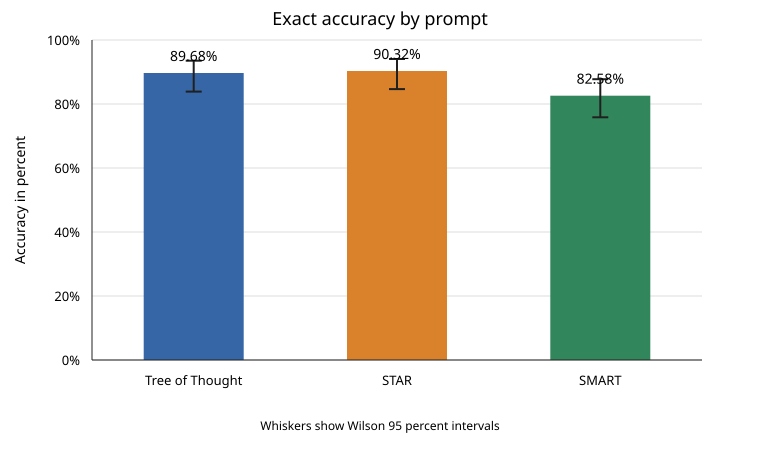
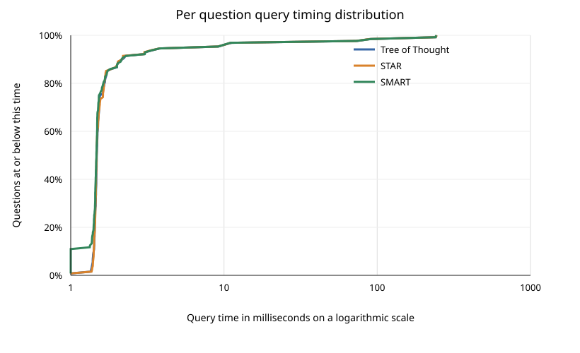

# Task 4 report

## What I compared

I compared the saved SQL predictions from Tree of Thought, STAR, and SMART on the same 155 restaurant questions. I looked at two things. The first was whether each query returned exactly the expected results. The second was how long each saved query took to run in SQLite.

The accuracy measure checks the returned rows, rather than the way the SQL is written. For timing, I included only the 128 questions all three approaches answered exactly correctly. Each query was warmed up twice and run seven times; I used the median of those runs for each question. These are database query times, not the time taken by a model to write an answer. Accuracy is still calculated across all 155 questions.

## Accuracy

STAR answered the most questions correctly, with Tree of Thought very close behind. SMART had the lowest accuracy.

<table>
<thead><tr><th>Prompt approach</th><th>Correct answers</th><th>Accuracy</th><th>95 percent interval</th></tr></thead>
<tbody>
<tr><td>Tree of Thought</td><td>139 of 155</td><td>89.68 percent</td><td>83.89 to 93.55 percent</td></tr>
<tr><td>STAR</td><td>140 of 155</td><td>90.32 percent</td><td>84.65 to 94.05 percent</td></tr>
<tr><td>SMART</td><td>128 of 155</td><td>82.58 percent</td><td>75.84 to 87.74 percent</td></tr>
</tbody>
</table>

I used exact McNemar tests because each approach was tested on the same questions. This compares the questions where one approach was right and the other was wrong. I adjusted the pairwise results with the Holm method to account for making several comparisons.

The accuracy intervals are Wilson intervals. The tests use the paired question outcomes, rather than treating each prompt as a separate set of questions.

<table>
<thead><tr><th>Comparison</th><th>Questions favoring the first approach</th><th>Questions favoring the second approach</th><th>Adjusted p value</th><th>Conclusion</th></tr></thead>
<tbody>
<tr><td>Tree of Thought and STAR</td><td>0</td><td>1</td><td>1.000</td><td>No reliable difference</td></tr>
<tr><td>Tree of Thought and SMART</td><td>11</td><td>0</td><td>0.00195</td><td>Tree of Thought was more accurate</td></tr>
<tr><td>STAR and SMART</td><td>12</td><td>0</td><td>0.00146</td><td>STAR was more accurate</td></tr>
</tbody>
</table>

The one answer separating STAR from Tree of Thought is not enough to show a meaningful accuracy difference. SMART, however, missed a group of questions that Tree of Thought and STAR answered correctly. Those differences are statistically significant in this set of questions.

## Query execution time

The approaches had very similar query times on the shared correct questions. SMART had the lowest mean and median in this run, though the timing analysis did not find a statistically reliable overall difference.

<table>
<thead><tr><th>Prompt approach</th><th>Mean milliseconds per query</th><th>Median milliseconds per query</th><th>95th percentile milliseconds</th></tr></thead>
<tbody>
<tr><td>Tree of Thought</td><td>6.802</td><td>1.479</td><td>9.228</td></tr>
<tr><td>STAR</td><td>6.784</td><td>1.475</td><td>9.103</td></tr>
<tr><td>SMART</td><td>6.677</td><td>1.471</td><td>9.159</td></tr>
</tbody>
</table>

The overall Friedman test did not find evidence that query times differed across the approaches on this shared set. Its test statistic was 2.02 and its p value was 0.365. I followed it with paired Wilcoxon signed rank tests and adjusted those p values with the Holm method. The overall result uses a chi square approximation, while the pairwise results use a normal approximation.

<table>
<thead><tr><th>Comparison</th><th>Typical difference</th><th>Adjusted p value</th><th>Conclusion</th></tr></thead>
<tbody>
<tr><td>Tree of Thought and STAR</td><td>Tree of Thought was 0.0002 milliseconds quicker</td><td>0.313</td><td>No reliable difference</td></tr>
<tr><td>Tree of Thought and SMART</td><td>SMART was 0.0031 milliseconds quicker</td><td>0.0555</td><td>No reliable difference after adjustment</td></tr>
<tr><td>STAR and SMART</td><td>SMART was 0.0031 milliseconds quicker</td><td>0.313</td><td>No reliable difference</td></tr>
</tbody>
</table>

The timing differences are small, and none of the pairwise results remained statistically significant after adjustment. These timings describe only questions all approaches answered correctly, which makes them more useful for comparing the speed of successful answers. They still apply only to this database and these saved queries.

## Why the results may differ

The SMART instructions say that a request for one restaurant should return at most one match. That is a reasonable way to keep an answer focused, but it can miss the expected results when a question asks for a restaurant in a broad area or asks for some restaurants. Several of the questions where SMART fell behind involved broad areas, rating thresholds, or requests that could have more than one matching answer. This is consistent with the lower accuracy, although the saved results cannot prove that this instruction caused every error.

Tree of Thought encourages consideration of possible interpretations before writing a query. STAR gives the query a structured situation, task, action, and result. Either style could help keep table joins and filters organized. Their scores are almost the same here, so this small comparison does not show that one structure is better.

The query timings describe the SQL that was saved, not the reasoning process that produced it. Different SQL shapes, the number of rows returned, SQLite planning, and occasional broad searches can all affect execution time. The database is small, so the timing results should not be treated as a prediction of performance on a larger system.

## What I can and cannot conclude

The saved prediction files do not record separate hosted model sessions. They also do not identify the model version or the coding agent that produced each file. As a result, I cannot separate the effect of the prompt from possible differences in the model, the agent, or how the SQL was prepared. The prompt descriptions help explain possible reasons for the observed pattern, but they are not enough to establish cause and effect.

For these saved predictions, STAR and Tree of Thought have similar accuracy, while SMART is less accurate. The accuracy tests support a real difference between SMART and the other two approaches on these questions. On the questions all three answered correctly, the timing analysis did not find reliable differences between approaches. These conclusions apply to this dataset and these stored queries.
