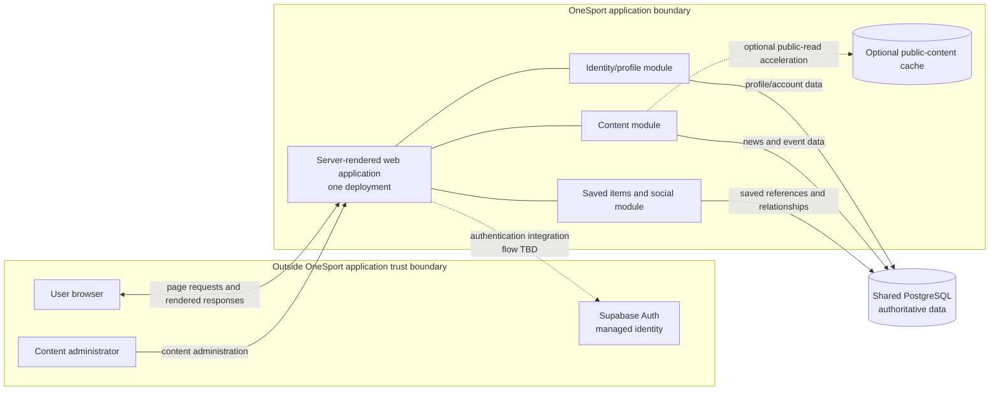

# ADR-001: OneSport Initial Architecture

- **Status:** Proposed — architecture selected; implementation questions remain
- **Date:** 2026-10-27
- **Decision owners:** OneSport project team

## Context

OneSport's stated requirements include account signup/login/logout, profile and credential changes, account deletion, browsing/filtering news and tickets, saved items, friend requests and friendships, and finding users by email. The requirements do not specify traffic, availability targets, client-platform constraints, budget, or the team’s operational capacity.

The prior ADR added context beyond `data/OneSport.txt`: Supabase Auth, admin-managed news/events, no ticket checkout, shared PostgreSQL, and retention of deleted users’ collections for 90 days. In this discussion, the user reaffirmed Supabase Auth, shared PostgreSQL, and the 90-day retention choice. Admin-managed content and no payment processing remain inherited scope assumptions, not requirements confirmed in this discussion.

The user prioritized first-release simplicity and chose a server-rendered monolith over a SPA + modular monolith or microservices. This is a proposed initial architecture, not a claim that future independent scaling is unnecessary.

## Decision

Build OneSport as a **server-rendered monolithic web application** backed by one PostgreSQL service. The application handles page rendering and all OneSport domain behavior: account/profile mapping, content, saved news/ticket references, and social relationships. Supabase Auth handles email/password authentication; it does not replace OneSport’s application data or account-deletion responsibilities.

Keep internal code organized around identity/profile, content, and user features, but do not introduce network service boundaries or a gateway. The monolithic application is the authority for these domains and accesses its PostgreSQL database. Use internal module boundaries and ownership conventions to make later change possible without implying that these modules are independently deployed or independently scalable.

| Component | Responsibility / ownership | Deployment / trust boundary |
|---|---|---|
| Browser | Displays rendered pages and submits user actions; no direct database access | User-controlled client outside the application trust boundary |
| Server-rendered web application | Renders pages; owns OneSport profile mapping, content workflows, saved-item references, friend requests, and friendships | One application deployment; internal domain modules are not independent services |
| Supabase Auth | Email/password authentication and managed provider identity | External managed service; trust boundary and integration details require validation; plan/region not selected |
| PostgreSQL service | Authoritative persistence for OneSport application data | One shared managed PostgreSQL service; reachable by the application, not the browser; hosting and capacity not selected |
| Content cache | Optional acceleration for public content reads | Add only if measurements justify it; cache product and policy require confirmation; never authoritative |

The diagram shows logical modules within one application deployment, not independently deployed services. Supabase authentication flow is intentionally dotted because browser/server token and session handling has not been decided. The application renders news, ticket/event information, saved lists, profiles, and social features. Saved lists store stable references to news or ticket content rather than duplicating full content fields. The application resolves references when rendering saved lists. Ticket checkout/payment is out of scope under the inherited prior-ADR assumption.

| User flow | Request and data path | Boundary / failure consideration |
|---|---|---|
| Sign up / sign in | Browser submits the authentication action; the OneSport application integrates with Supabase Auth and maps the provider identity to OneSport profile data in PostgreSQL. | Exact browser-to-provider versus server-mediated flow, session establishment, and provider outage behavior are open. Never treat a user-supplied identity as verified. |
| Browse/filter news or tickets | Browser requests a page; application reads content from PostgreSQL and may use an optional public-content cache. | PostgreSQL is authoritative. Cache freshness/fallback is not yet confirmed for this revised architecture. |
| Save/remove an item | Browser submits action; application verifies the user and updates their saved reference in PostgreSQL; rendered response reflects the result. | Keep authorization and write in the application; enforce duplicate prevention at persistence layer. |
| Send/accept/delete friend request | Browser submits action; application applies relationship rules and persists the transition in PostgreSQL. | Conflicting concurrent actions need a defined state transition/constraint; no service-to-service workflow is involved. |
| Delete account | Browser requests deletion; application coordinates Supabase identity/session handling and OneSport records under the retention policy. | OneSport and Supabase changes are not assumed to be one atomic transaction; retries/progress and 90-day recovery semantics remain open. |

## Alternatives considered

| Alternative | Request/data flow and consistency | Scaling and failure behavior | Implementation/operations; decision |
|---|---|---|---|
| **Server-rendered monolith — selected** | Browser requests pages/actions from one application; application modules read/write PostgreSQL. Local transactions are straightforward for saved items and relationship state. | Application scales as one unit; content load can contend with identity/social work. Fewer network dependencies, though application and database outages affect the whole product. | Fewest application deployments and simpler debugging; still requires secure sessions, rendering/form handling, and database operations. Chosen for first-release simplicity and requested page-oriented experience. |
| **SPA + modular monolith** | SPA calls one backend; internal modules use one application/database boundary. Local transaction benefits remain. | Backend still scales as one unit; SPA delivery and API introduce another client/runtime boundary. | More client/API integration work than server rendering, without independent content deployment. Not selected after the user chose server-rendered pages. |
| **SPA + microservices** | SPA calls gateway and services; cross-domain screens compose results across calls. Cross-service operations lack one local transaction. | Content service can scale separately, but gateway and PostgreSQL remain shared dependencies. Network failures and partial responses require explicit handling. | Highest burden: gateway/service auth, deployment, observability, durable deletion orchestration, and integration testing. No concrete traffic/availability need currently justifies this complexity. |

## Consequences

**Benefits**

- One application and database simplify initial deployment, local transactions, debugging, and operational ownership.
- Account, saved-item, and social workflows can use database transactions where their data is local to the application.
- Supabase Auth avoids operating password authentication infrastructure, while OneSport retains control of profile mapping and application records.
- Internal domain boundaries leave room to refactor or extract a module if measured needs later justify it.

**Costs and risks**

- Web application capacity is scaled as a unit; content-heavy reads may consume resources needed by account and social features.
- The application and PostgreSQL service are critical dependencies. Their availability, backups, restore procedures, and capacity need operational plans.
- Shared PostgreSQL is a common resource and failure domain. Separate service/database scaling is not part of this decision; adding database nodes alone does not guarantee horizontal write scaling.
- A server-rendered client may not provide the same interaction model as an SPA. The user explicitly chose this trade-off for the first release.
- Supabase Auth does not perform complete OneSport deletion: profile data, sessions, saved references, friendships, and retained records require OneSport lifecycle rules.
- Retaining collections for 90 days is not full anonymization if data can be reattached to an account. Recovery and visibility rules must be specified before implementation and communicated accurately.

## Data and runtime considerations

- PostgreSQL is authoritative. If a public-content cache is introduced, it is non-authoritative and must not serve personalized saved-list responses. The prior ADR proposed a five-minute normal TTL and a bounded stale fallback, but applicability of that cache policy to this simpler architecture has not been confirmed in this discussion.
- Account deletion must disable or revoke authentication/session access and apply the agreed retention and cleanup rules. The prior 90-day choice retains deleted users’ collections, invisible to other users, before deletion; whether the user can recover the account during that window, how records are reattached, and how friendships/requests are handled remain open.
- Use database constraints/transactions for uniqueness and state transitions where applicable (for example, duplicate saved references and competing friend-request decisions). Exact schema and behavior are implementation decisions, not established by the requirements.
- The Supabase-to-server-session flow, cookie/session storage, CSRF protections, expiry, and revocation behavior must be settled and implemented securely. No particular token-flow mechanism is selected here.

## Evolution and validation

Begin with one server-rendered application and one managed PostgreSQL service. Measure request latency, application resource use, database load, and content-read volume. Address query/index issues and application-level caching before introducing independently deployed services. If content demonstrably needs independent scaling or deployment, revisit a content-service extraction with explicit ownership and failure behavior; do not assume shared PostgreSQL can scale writes horizontally by adding nodes.

Before relying on lifecycle guarantees, test account deletion and interruption/retry behavior, 90-day expiry, duplicate saves, and concurrent friend-request decisions. Test database backup restoration. Confirm whether a cache is needed from observed read load rather than adding it by default.

## Open questions before implementation

1. Can a user recover an account during the 90-day retention window? If so, which identity and collection data must remain recoverable, who may access it, and when is deletion irreversible?
2. When an account is deleted, which friendships and pending requests are removed or retained, and what should the other users see?
3. How will the application integrate with Supabase Auth and establish server-side sessions? Decide token handling, expiry, logout/revocation, recovery behavior, and CSRF protection.
4. Is content entered and managed by administrators? If so, which administrator roles and access controls are required? (Admin-managed content is inherited from ADR-001, not specified in `OneSport.txt`.)
5. Which PostgreSQL host and region will be used, and what backup, restore, and capacity objectives are required?
6. Is a content cache needed at launch? If so, should the prior five-minute normal TTL and stale-outage fallback policy apply?
7. What measured traffic, latency, resource, or availability thresholds would justify another application replica, a separate content deployment, or a changed database strategy?
8. Does OneSport handle ticket checkout or payments, or only display/save ticket information and links? The requirements' overview mentions purchasing tickets, while the user stories describe viewing and saving tickets; the previous ADR excluded payments, but this was not confirmed in this discussion.
