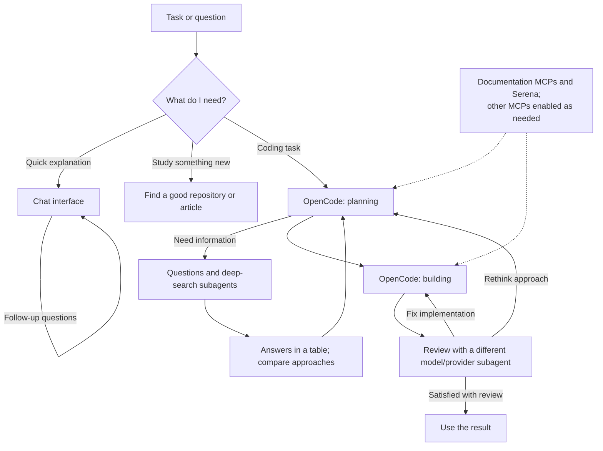

# My typical workflow with LLMs

Usually, I have two modes in OpenCode: planning and building. When I need to think something through, I start with planning and then implement it in building mode. If I need information, I ask questions, ask for the answers in a table, and tell the assistant to run a deep-search subagent for each question and compare different approaches.

To verify results, I use different models. In my OpenCode workflow, I run a subagent using a model from a different provider to get another opinion. If the review raises problems, I go back to planning or building and check the result again. A second model's answer is another opinion, not a guarantee that the result is correct.

I use chat interfaces to understand abstract topics when I just need a simple explanation or have a few questions. If I want to study something new more seriously, I find a good repository or article on the web.

My instructions tell the assistant to call subagents whenever needed, and I also explicitly ask for them for research. I have many MCP servers, but I enable most of them only when they are needed for the current task. I normally keep documentation MCPs enabled and use Serena for better interaction with and changes to code. There are probably other details in my workflow, but these are the main ones I remember right now.

## Workflow figure

*Figure 1. My usual routes for learning, coding, research, and cross-model validation.*
